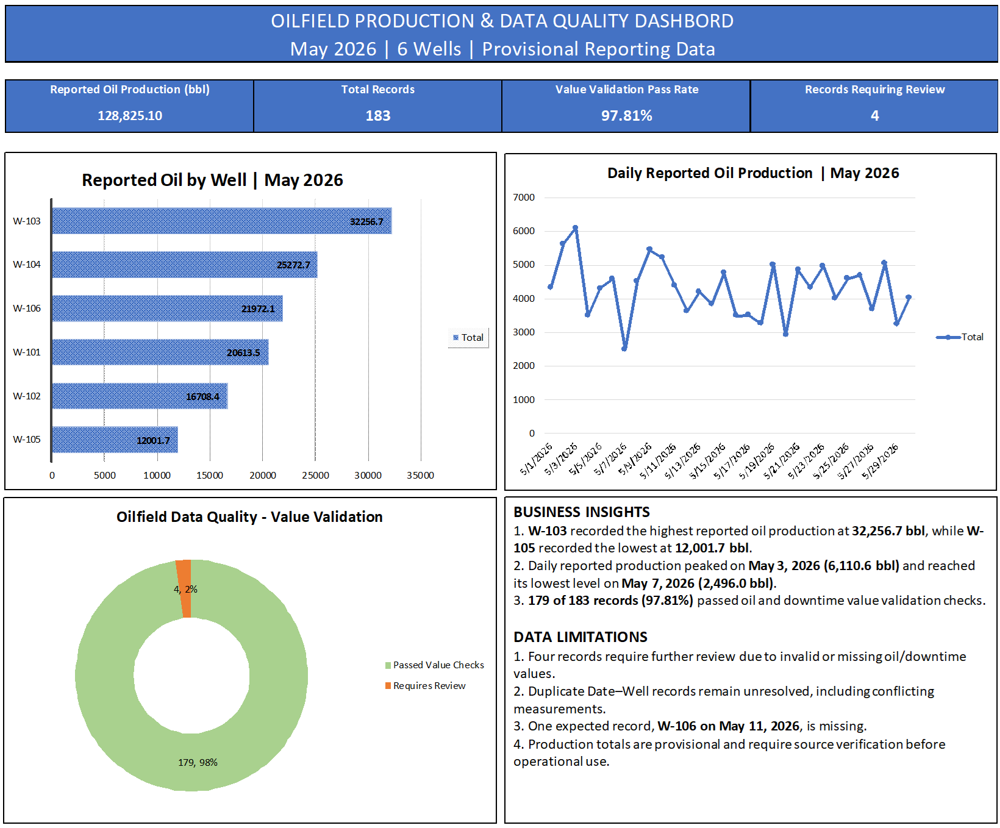

# Oilfield Production & Data Quality Analysis

**Excel & Power Query | Data Analytics Portfolio Project**

## Project Overview

This project analyzes simulated oilfield production data from six wells during May 2026. The primary objective is to evaluate production performance, identify data quality issues, and develop an interactive Excel dashboard that communicates operational insights.

The project demonstrates practical data analytics skills, including data preparation, data validation, exploratory analysis, visualization, and business reporting.

## Business Objectives

- Analyze reported oil production across six wells.
- Identify the highest- and lowest-producing wells.
- Evaluate daily production trends.
- Detect missing, duplicate, and invalid records.
- Develop an Excel dashboard with operational KPIs.
- Communicate business insights and data quality limitations.

## Tools & Technologies

- Microsoft Excel 2021
- Power Query (data cleaning and transformation)
- PivotTables and PivotCharts
- Excel formulas and KPI calculations
- Data quality validation and reconciliation

## Dataset Description

The project uses a simulated oilfield production dataset covering May 1–30, 2026.

| Dataset Attribute | Value |
|---|---|
| Total records | 183 |
| Reporting period | May 1–30, 2026 |
| Number of wells | 6 |
| Expected Date–Well combinations | 180 |
| Unique Date–Well combinations | 179 |
| Source format | CSV |

### Dataset Fields

- **Date:** Production reporting date.
- **Well ID:** Unique identifier for each oil well.
- **Oil Production (bbl):** Reported daily oil production in barrels.
- **Downtime (hr):** Reported operational downtime in hours.
- **Wellhead Pressure (psi):** Recorded wellhead pressure.
- **Field:** Field location/category.

## Data Preparation & Cleaning

Power Query was used to prepare and validate the dataset.

The workflow included:

1. Importing the original CSV dataset.
2. Assigning appropriate data types.
3. Standardizing inconsistent well identifiers.
4. Identifying missing and invalid production values.
5. Validating downtime values against operational constraints.
6. Detecting duplicate Date–Well records.
7. Comparing actual reporting combinations against expected combinations.
8. Creating validation flags and a reporting dataset for dashboard analysis.

Original records were retained when source verification was required.

## Data Quality Assessment

The validation process identified the following results:

| Data Quality Metric | Result |
|---|---:|
| Total Records | 183 |
| Expected Date–Well Combinations | 180 |
| Unique Date–Well Combinations | 179 |
| Missing Date–Well Combinations | 1 |
| Extra Duplicate Records | 4 |
| Records Passing Value Validation | 179 |
| Records Requiring Value Review | 4 |
| Value Validation Pass Rate | 97.81% |

### Identified Data Quality Issues

**1. Missing reporting combination**

The expected record for W-106 on May 11, 2026, was missing.

**2. Exact duplicate records**

Two Date–Well combinations contained identical duplicate records.

**3. Conflicting duplicate records**

Two Date–Well combinations contained conflicting measurements that require source verification.

**4. Invalid or missing values**

The dataset contained missing or invalid oil production and downtime values, including a negative production value and a downtime value exceeding 24 hours.

The identified issues were documented rather than automatically corrected without supporting evidence.

## Key Findings

### Production Performance

- **Total reported oil production:** 128,825.1 bbl.
- **Highest-producing well:** W-103, with 32,256.7 bbl.
- **Lowest-producing well:** W-105, with 12,001.7 bbl.

### Daily Production Trends

- **Highest reported daily production:** 6,110.6 bbl on May 3, 2026.
- **Lowest reported daily production:** 2,496.0 bbl on May 7, 2026.

### Value Validation Results

- 179 of 183 records passed oil and downtime value validation checks.
- Four records required additional review.
- The value validation pass rate was 97.81%.

All reported production results are provisional because unresolved data quality issues remain.

## Dashboard Preview



The Excel dashboard includes:

- Reported Oil Production KPI
- Total Records KPI
- Value Validation Pass Rate KPI
- Records Requiring Review KPI
- Reported Oil Production by Well chart
- Daily Reported Oil Production Trend chart
- Data Quality Validation Doughnut Chart
- Business Insights and Data Limitations

## Business Recommendations

1. Investigate and reconcile duplicate Date–Well records before final production reporting.
2. Recover or verify the missing W-106 record for May 11, 2026.
3. Validate missing and abnormal production and downtime values against source records.
4. Establish consistent reporting and validation rules.
5. Recalculate production KPIs after unresolved data quality issues have been addressed.

## Data Limitations

This project uses simulated data for educational and portfolio purposes.

The dataset contains unresolved duplicate records, conflicting measurements, missing reporting combinations, and invalid or missing values.

The 97.81% validation pass rate measures oil and downtime value checks only. It does not represent an overall data quality score.

Reported production totals are provisional and should not be used for actual operational decisions without additional verification.

## How to Use the Excel Workbook

1. Download `Oilfield_Production_Analysis.xlsx` and `Oilfield_Power_Query_Practice_183_Rows.csv`.
2. Open the workbook using Microsoft Excel with Power Query support.
3. Navigate to the `Oilfield_Dashboard` worksheet to review the KPIs and visualizations.
4. Explore the PivotTable and data quality worksheets to review the analysis.
5. Follow the refresh instructions below if you need to reload the source data.

## How to Refresh the Excel Dashboard

The workbook uses a configurable Power Query parameter named `pCSVFilePath`.

To refresh the data:

1. Save the downloaded CSV file to a local folder.
2. Open the Excel workbook.
3. Select **Data → Queries & Connections**.
4. Open the Power Query Editor by editing the source query.
5. Select **Home → Manage Parameters → Edit Parameters**.
6. Update `pCSVFilePath` with the full local path of the CSV file.
7. Select **Close & Load**.
8. Return to Excel and select **Data → Refresh All**.
9. If necessary, refresh the PivotTables individually.
10. Confirm that the dashboard displays the expected results.

**Important:** The original local file path will not work on another computer. Users must update the parameter to match their own downloaded CSV location.

## Project Validation

The workbook was tested for:

- KPI reconciliation against PivotTable results.
- Data quality audit consistency.
- Successful Power Query refresh.
- Dashboard consistency after changing the source query to use a parameter.

The testing confirmed consistent results with the original simulated dataset. Cross-computer portability has not yet been independently verified.

## Project Structure

```text
Oilfield-Production-Data-Analysis/
├── README.md
├── Oilfield_Production_Analysis.xlsx
├── Oilfield_Power_Query_Practice_183_Rows.csv
├── screenshots/
│   └── dashboard.png
└── documentation/
    ├── Data_Quality_issue_Log.xlsx
    └── Final_QA_Report.md
```

The project structure may be adjusted to reflect the final uploaded files.

## Project Status

**Excel dashboard and initial quality assurance completed.**

The project is prepared for portfolio publication, with unresolved source-level data quality issues explicitly documented.

## Author

**Glend Daniel Dariwu**

Petroleum Engineering Graduate | Aspiring Data Analyst

**Skills demonstrated:** Excel, Power Query, Data Cleaning, Data Validation, PivotTables, Data Visualization, Business Analysis, and Data Quality Reporting.
